# Guía de uso con capturas

Simulador de un orquestador que reparte 60 SIMs de datáfonos en pools de datos. Todo es sintético.
Prueba en línea: https://juanxd2201.github.io/claro-bold-sim/ (no hay que instalar nada).

Las capturas están en modo oscuro; hay modo claro con el botón **Tema**.

## Barra superior (siempre visible)

Reloj simulado (`Periodo 1 · Día 4/30`), **Reproducir/Pausar**, velocidad **1x / 5x / 20x**, **+1 día**, **A fin de periodo**,
**Reiniciar periodo** (cierra el periodo), **Reiniciar todo** (vuelve a la semilla inicial) y **Escenarios**.
A la derecha: modo del orquestador (supervisado/automático), campana de **Alertas** con contador y **Tema**.

### Escenarios
Cada botón reinicia la simulación y la deja lista para probar un caso.

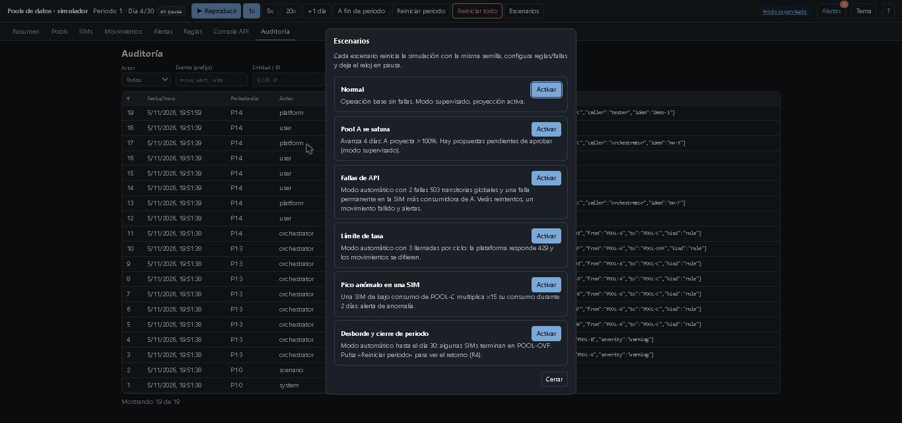

## 1. Resumen
Tarjetas (SIMs activas, consumo, excedente, movimientos pendientes, alertas), gráfico de uso por pool contra las líneas de
umbral (80 %) y capacidad (100 %) con la proyección al día 30, y tabla de proyección por pool.

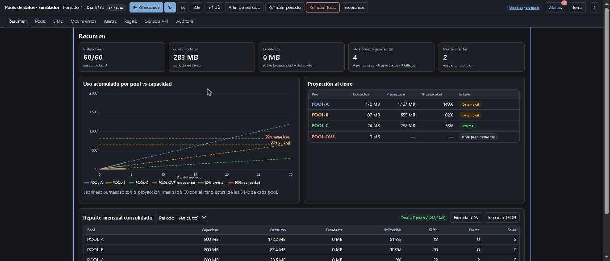

**Reporte mensual:** abajo del Resumen. Se elige el periodo y se exporta a CSV o JSON. El total siempre es la suma de los pools
(la etiqueta verde "Total = Σ pools ✓" lo confirma). Aquí el periodo 1 cerrado: 2.126,2 MB en total, 81,3 MB de excedente en el desborde.

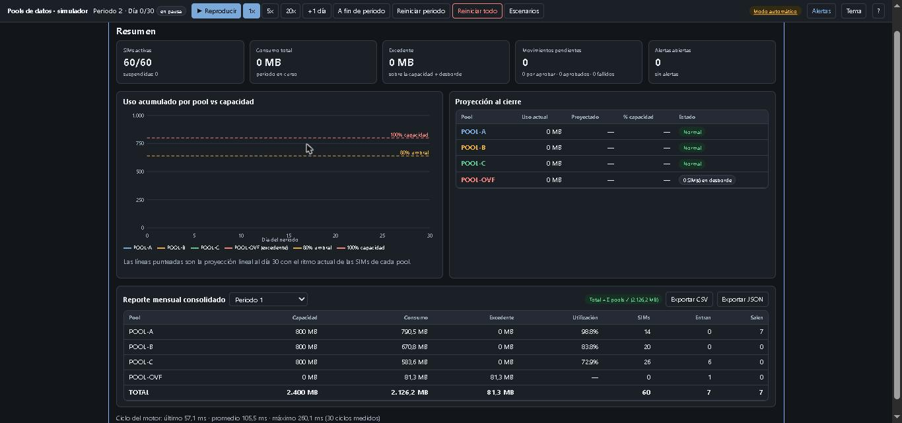

## 2. Pools
Una tarjeta por pool con barra de uso, marcador de proyección, SIMs y top de consumidoras. Para mover una SIM, **arrástrala a otro pool**
(pide confirmación y muestra el resultado de la API). Abre "SIMs (n)" para ver las SIMs de cada pool; el color del borde indica el perfil.

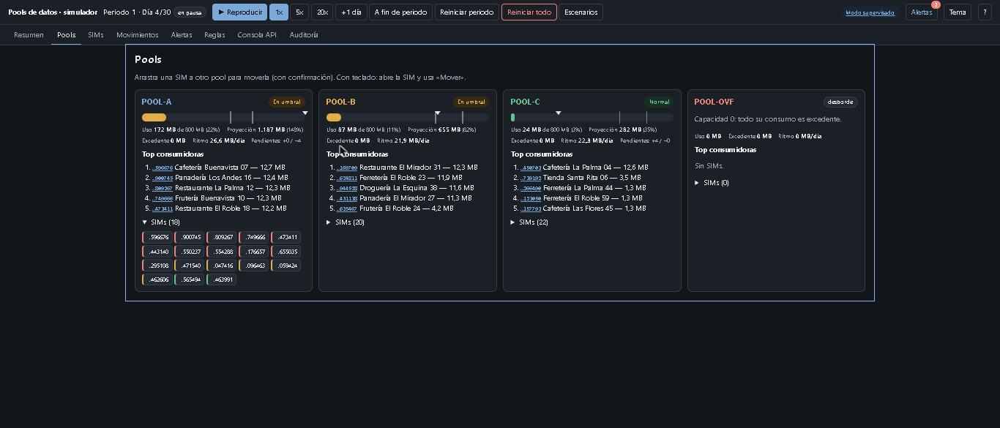

**Con desborde:** al final del periodo, las SIMs que no cupieron en ningún pool quedan en `POOL-OVF` y todo su consumo es excedente.

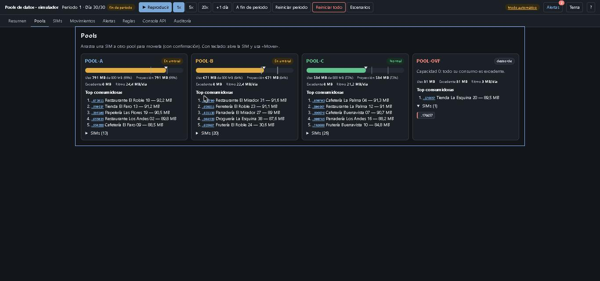

**Tras cerrar el periodo:** el consumo vuelve a cero y la SIM en desborde regresa a su pool de origen (regla R4).

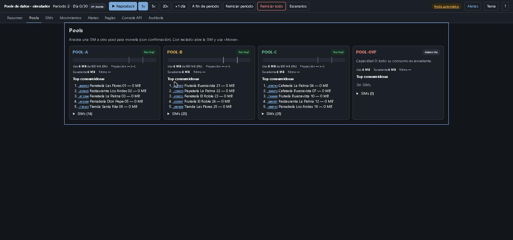

## 3. SIMs
Búsqueda por ICCID, MSISDN, comercio o datáfono; filtros combinables (pool, estado, perfil, ciudad, anomalía, movimiento pendiente,
movida recientemente, rangos de consumo). Los filtros quedan en la URL. Se ordena por columna, se seleccionan varias SIMs y aparecen
las acciones masivas: **Mover…, Suspender, Activar, Exportar CSV**.

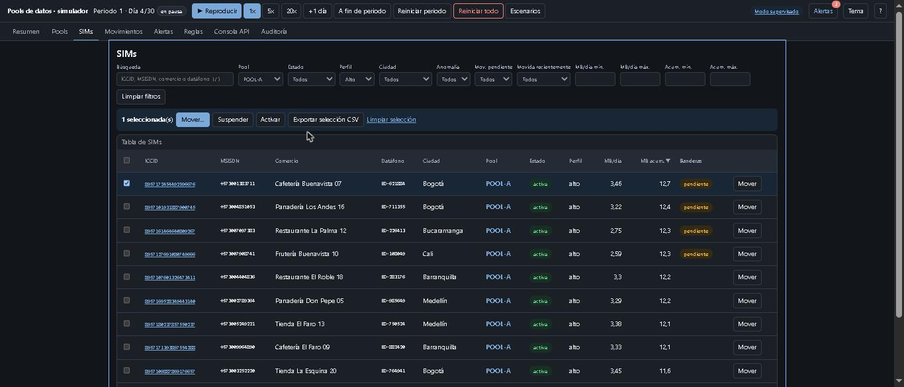

### Mover una SIM
Se elige el pool destino. El diálogo muestra la respuesta de la API (código HTTP, latencia y cuerpo).

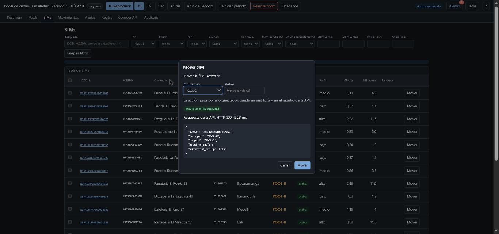

### Detalle de una SIM
Al hacer clic en un ICCID se abre el panel lateral: datos, gráfico de consumo diario y acumulado, movimientos, alertas y línea de
tiempo de auditoría. Desde ahí se puede mover, revertir el último movimiento o suspender.

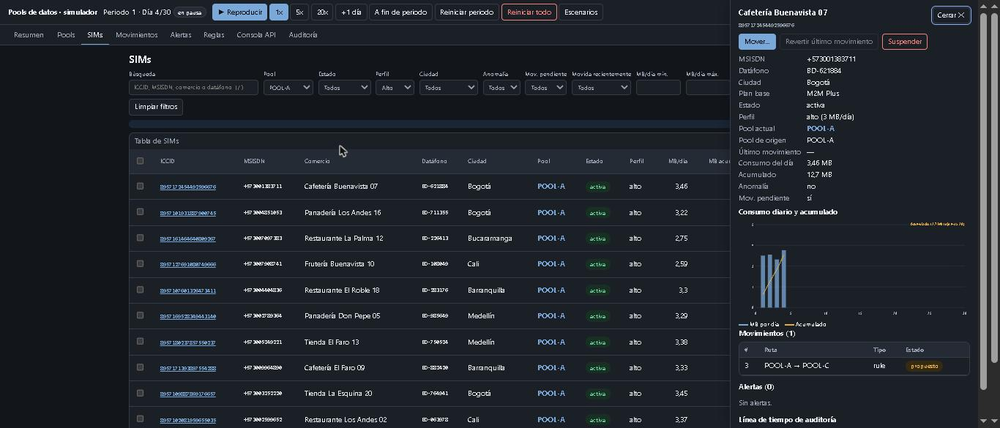

## 4. Movimientos
Cola con pestañas por estado (propuesto, aprobado, ejecutado, fallido, rechazado, revertido). En modo supervisado el orquestador solo
**propone**; tú **apruebas o rechazas** (uno o varios). Los fallidos se **reintentan** y los ejecutados se **revierten** (también por lote).

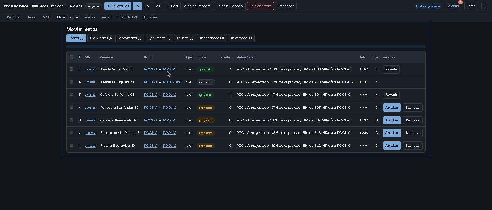

Un movimiento **fallido** muestra el error y cuántos intentos se hicieron (aquí 3 por una falla permanente inyectada):

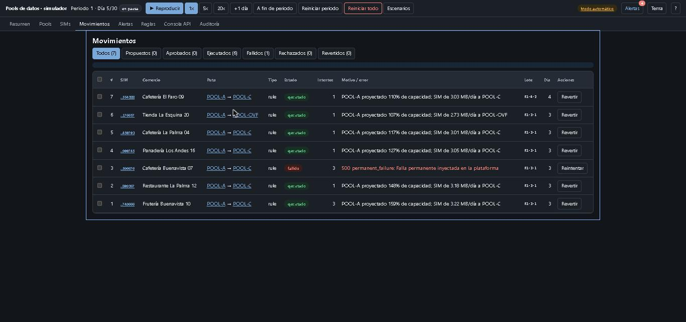

## 5. Alertas
Severidad, tipo (umbral, agotado, anomalía, falla de API, límite de tasa, conciliación) y estado. Se **reconocen** y **resuelven**;
el enlace lleva a la SIM o al pool.

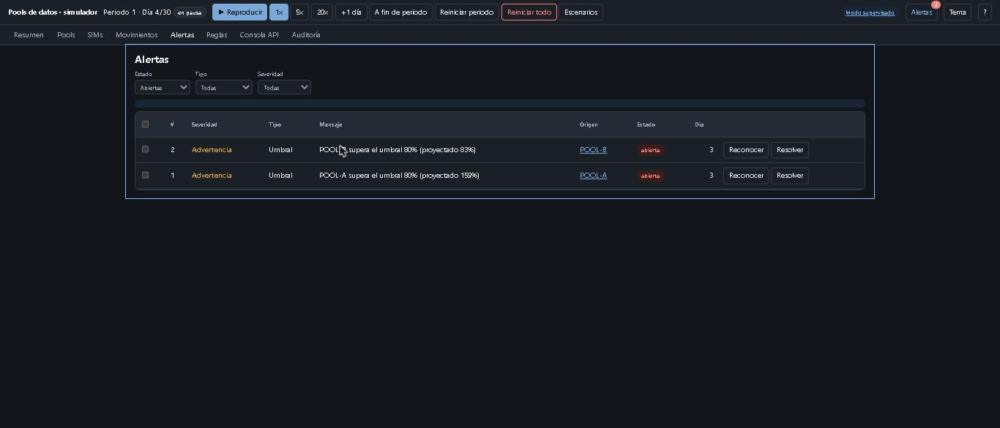

**Fallas de API:** una crítica (movimiento fallido tras 3 intentos) y una informativa (se recuperó tras reintentar).

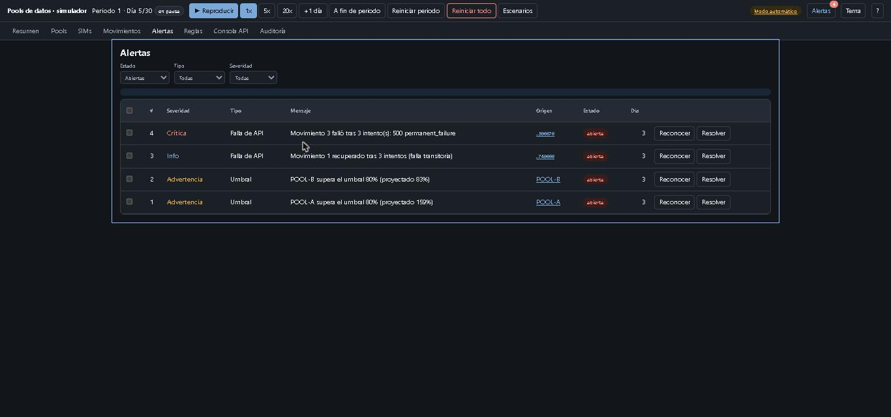

**Límite de tasa:** la plataforma respondió 429 y los movimientos quedaron diferidos.

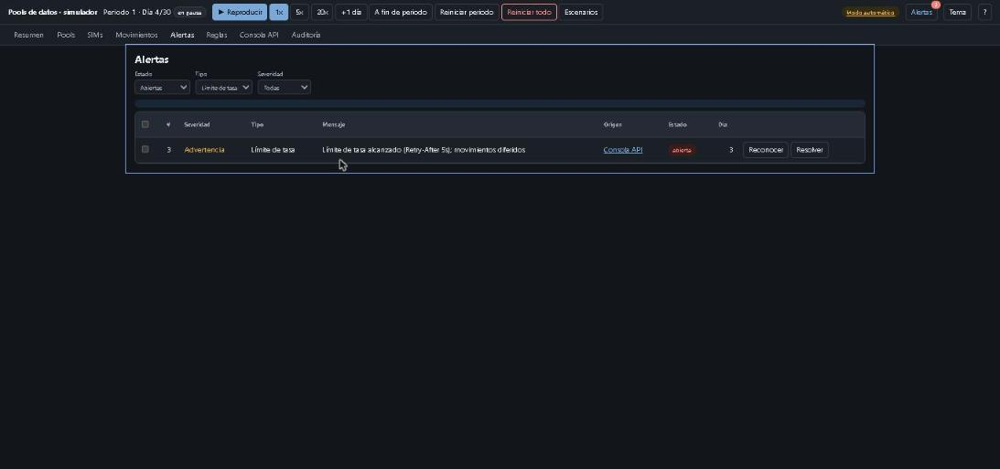

**Anomalía:** una SIM de bajo consumo (0,3 MB/día) llegó a 4,07 MB/día.

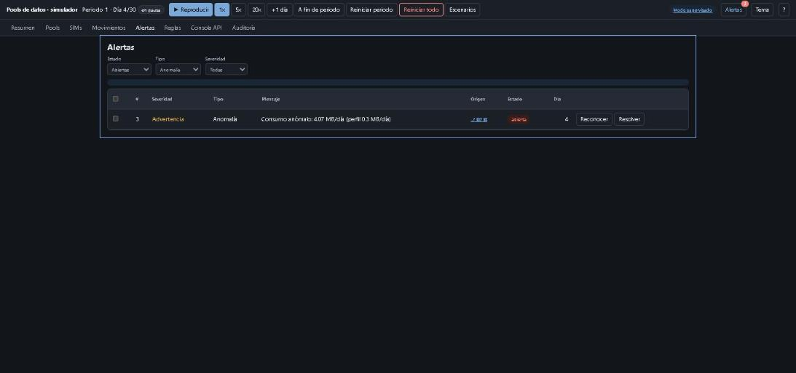

## 6. Reglas
Umbral de aviso y crítico, modo (supervisado/automático), disparador (real o proyectado), días mínimos de historial y límites.
A la derecha, una **vista previa** de los movimientos que se propondrían con los valores actuales, antes de guardar.

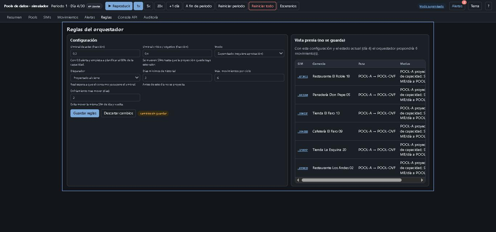

## 7. Consola API
Registro en vivo de las llamadas (origen, método, ruta, estado y latencia; "ver" muestra petición y respuesta), **probador de endpoints**
y condiciones de la API simulada. En la captura se envió dos veces el mismo movimiento con la misma `Idempotency-Key`: la segunda marca `Idempotent-Replay` y no mueve la SIM otra vez.

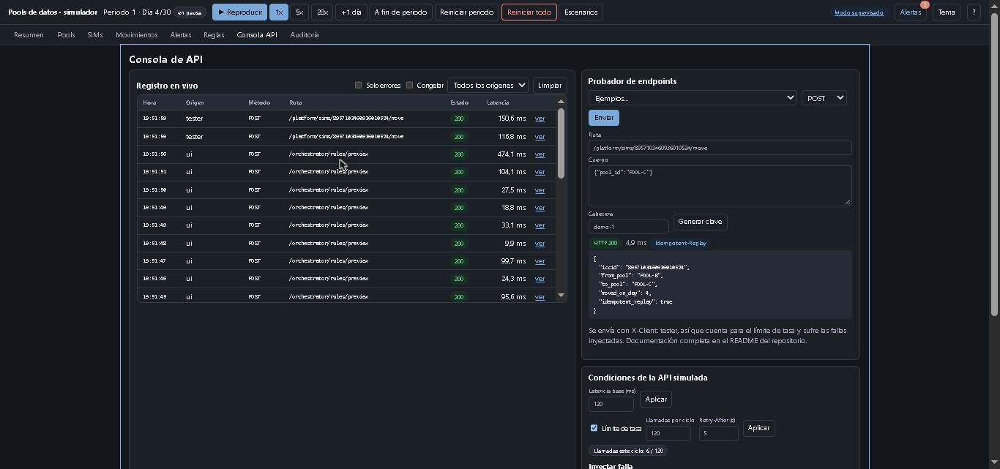

Más abajo: latencia, límite de llamadas por ciclo, inyección de fallas (transitorias/permanentes, globales o por SIM) y la medición de cada ciclo del motor.

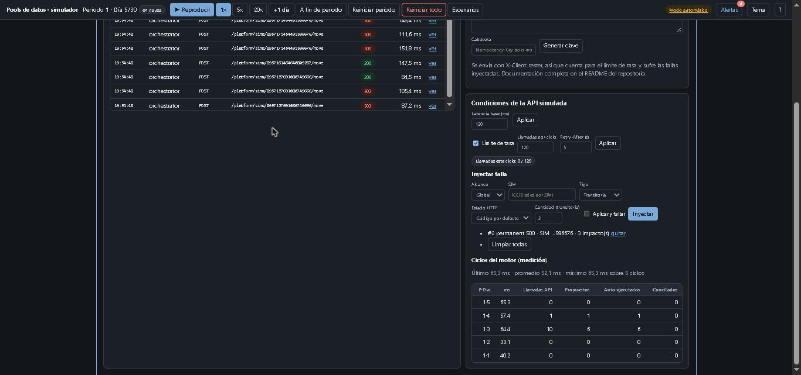

## 8. Auditoría
Todo lo que pasa queda registrado (actor, evento, entidad, detalle). Se filtra por actor, evento, entidad y fecha, y se exporta a CSV.

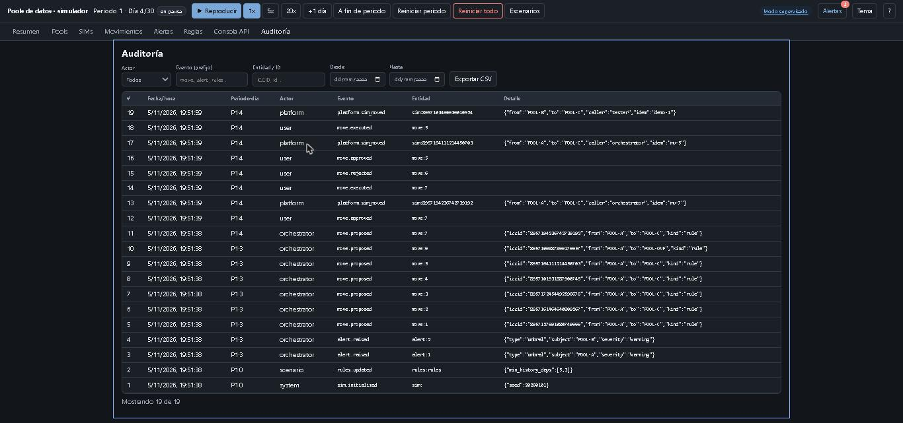

## Otros
**Modo claro:**

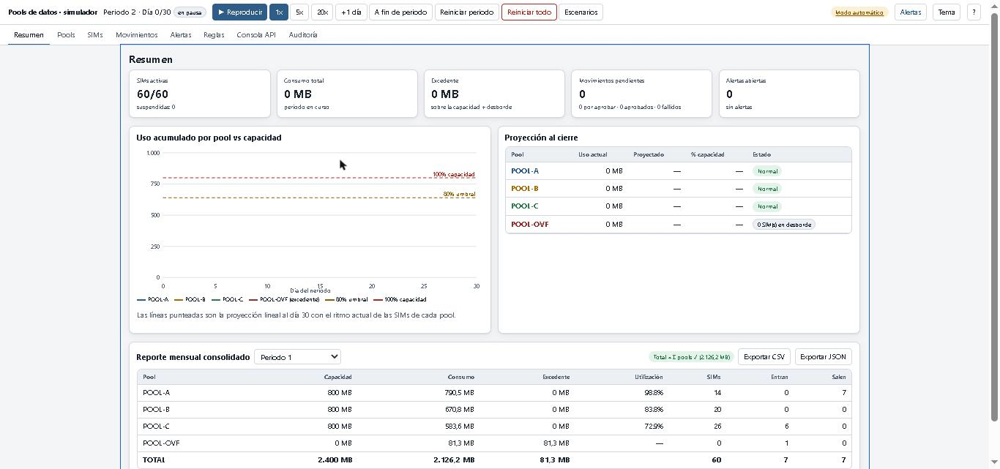

**Móvil (390 px):** la barra se acomoda en varias filas y las vistas no tienen scroll horizontal.

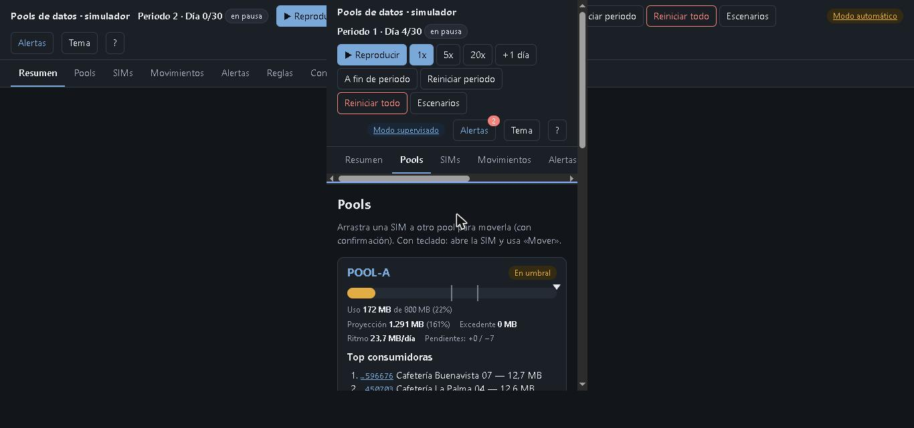

**Atajos de teclado:** `Espacio` reproduce/pausa, `n` avanza un día, `1`–`8` cambia de vista, `/` busca SIM, `?` muestra la ayuda.
